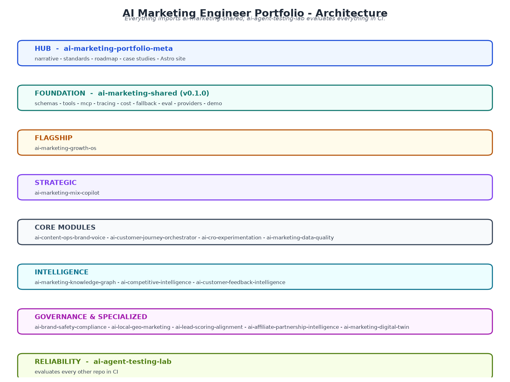

---
AIGC:
    Label: "1"
    ContentProducer: 001191440300708461136T1XGW3
    ProduceID: a60f8e46820ea466ef0868a20e79d739_ce891e7ac90811f18b7f525400393706
    ReservedCode1: ckveJdl0ASp5JoVKd2eqN/fPcPUWizQIu5cQW2c7RAd2oRF+1obXQPA1QIH9Giowya703vOQMgw8hjoGWnDTGIuS3zqK5h+MzHA8QqgnHfvkP4azqqvB/J/GyHsTFiTVFTsuFhQjoMMMt4nloz0OJWn+Jwp8KoX3XFXYD7X+PL9h1HqSXZJCvGgP0QU=
    ContentPropagator: 001191440300708461136T1XGW3
    PropagateID: a60f8e46820ea466ef0868a20e79d739_ce891e7ac90811f18b7f525400393706
    ReservedCode2: ckveJdl0ASp5JoVKd2eqN/fPcPUWizQIu5cQW2c7RAd2oRF+1obXQPA1QIH9Giowya703vOQMgw8hjoGWnDTGIuS3zqK5h+MzHA8QqgnHfvkP4azqqvB/J/GyHsTFiTVFTsuFhQjoMMMt4nloz0OJWn+Jwp8KoX3XFXYD7X+PL9h1HqSXZJCvGgP0QU=
---

# AI Marketing Engineer — Portfolio Hub

[](LICENSE)
[](https://python.org)
[](site/)

> A governed, evidence-driven AI marketing engineering portfolio.
> **One coherent architecture. Seventeen production-grade repositories. Zero API keys required to run any of them.**

This repository is the hub that ties the entire portfolio together: the narrative, the shared standards, the roadmap, the architecture, and the case studies. Land here and understand the whole portfolio in five minutes.

---

## The narrative

> "I am a digital marketing leader who can design, build, evaluate, and ship governed AI systems that solve real marketing problems. I understand measurement, incrementality, content, lifecycle, compliance, and data quality. I build with modern AI engineering practices: tool-using agents, MCP, structured outputs, human-in-the-loop, observability, and evaluation. I do not build demos. I build systems."

The differentiator is **not** the number of agents. It is that every system:

- Produces **evidence-backed recommendations** (cites data, metrics, or model output)
- Uses **tools safely** (defined functions, least-privilege permissions, never hallucinated numbers)
- Passes **meaningful evaluations** (labeled datasets, pass/fail metrics, reported in CI)
- Measures **real outcomes** (approval queue with pending/approved/rejected/executed/measured states)
- Runs **without cost** (rule-based demo mode + precomputed fixtures, zero API keys)
- **Documents itself** (README, architecture, evaluation, cost-controls in every repo)
- Fits into **one coherent architecture** (everything imports `ai-marketing-shared`)

## Architecture at a glance



Source: [docs/diagrams/architecture.mmd](docs/diagrams/architecture.mmd) · Full design discussion: [docs/architecture.md](docs/architecture.md)

Every repository depends on [ai-marketing-shared](../ai-marketing-shared) for schemas, tooling, tracing, cost accounting, evaluation, and provider abstraction. The [ai-agent-testing-lab](../ai-agent-testing-lab) evaluates every other repository in CI. This hub documents the standards and roadmap that keep all seventeen repositories consistent.

## The 17 repositories

| # | Repository | Phase | Status | Purpose |
|---|-----------|-------|--------|---------|
| 1 | [ai-marketing-portfolio-meta](../ai-marketing-portfolio-meta) | A · Shared Foundation | In progress | Portfolio hub: narrative, standards, roadmap, architecture, case studies, hub site |
| 2 | [ai-marketing-shared](../ai-marketing-shared) | A · Shared Foundation | Done · v0.1.0 | Shared Python package: Pydantic schemas, tool base classes + permissions, MCP adapter, tracing, cost accounting, rule-based fallback, eval harness, provider abstraction |
| 3 | [ai-marketing-growth-os](../ai-marketing-growth-os) | B · Flagship | Planned | Agentic marketing intelligence platform — the virtual digital marketing department |
| 4 | [ai-marketing-mix-copilot](../ai-marketing-mix-copilot) | C · Strategic | Planned | Bayesian MMM + incrementality measurement + budget scenario planning |
| 5 | [ai-content-ops-brand-voice](../ai-content-ops-brand-voice) | D · Core Modules | Planned | Agentic content planning, drafting, review, publishing, measurement |
| 6 | [ai-customer-journey-orchestrator](../ai-customer-journey-orchestrator) | D · Core Modules | Planned | Real-time next-best-action across email, SMS, push, ads, on-site |
| 7 | [ai-cro-experimentation](../ai-cro-experimentation) | D · Core Modules | Planned | Agentic conversion-rate optimization and experimentation |
| 8 | [ai-marketing-data-quality](../ai-marketing-data-quality) | D · Core Modules | Planned | Agentic monitoring of marketing data pipelines |
| 9 | [ai-marketing-knowledge-graph](../ai-marketing-knowledge-graph) | E · Intelligence | Planned | Unified marketing knowledge graph with natural-language querying |
| 10 | [ai-competitive-intelligence](../ai-competitive-intelligence) | E · Intelligence | Planned | Always-on competitive and market sensing |
| 11 | [ai-customer-feedback-intelligence](../ai-customer-feedback-intelligence) | E · Intelligence | Planned | Voice-of-customer intelligence from reviews, surveys, tickets, social, calls |
| 12 | [ai-brand-safety-compliance](../ai-brand-safety-compliance) | F · Governance | Planned | Governed review of ad copy, landing pages, creatives, influencer content |
| 13 | [ai-local-geo-marketing](../ai-local-geo-marketing) | F · Governance | Planned | Multi-location local marketing optimization |
| 14 | [ai-lead-scoring-alignment](../ai-lead-scoring-alignment) | F · Governance | Planned | Explainable lead scoring, routing, closed-loop revenue attribution |
| 15 | [ai-affiliate-partnership-intelligence](../ai-affiliate-partnership-intelligence) | F · Governance | Planned | Discover, vet, and optimize affiliate, influencer, partner programs |
| 16 | [ai-marketing-digital-twin](../ai-marketing-digital-twin) | F · Governance | Planned | Simulation sandbox for marketing scenarios before real-world execution |
| 17 | [ai-agent-testing-lab](../ai-agent-testing-lab) | G · Testing & Reliability | Planned | Reusable reliability and evaluation lab for all agents above |

Track build order and status: [docs/roadmap.md](docs/roadmap.md)

## Start here

1. **Read the standards** — [docs/standards.md](docs/standards.md) defines the shared schemas, tooling, repo template, CI, and design language used by every repository.
2. **Read the roadmap** — [docs/roadmap.md](docs/roadmap.md) shows build order, dependencies, and current status.
3. **Understand the architecture** — [docs/architecture.md](docs/architecture.md) explains design decisions and tradeoffs.
4. **Study the foundation** — clone [ai-marketing-shared](../ai-marketing-shared) first; every other repo imports it.
5. **Read the case studies** — [docs/case-studies/](docs/case-studies/) tells the story behind each major system: problem, approach, architecture, evaluation, results, lessons.
6. **Run the hub site** — `cd site && npm install && npm run dev` renders this hub as an Astro site (deployable to Vercel or GitHub Pages).

## The 12 core principles

Applied to every repository:

1. **Evidence over opinion** — every recommendation cites data, metric, or model output.
2. **Tool-using agents** — agents call defined functions; never hallucinate numbers.
3. **Structured outputs** — all agent outputs conform to shared Pydantic schemas.
4. **Human-in-the-loop** — no consequential action (publish, budget change, campaign edit, send message) happens without approval.
5. **Modularity** — AI providers, data sources, and tools are swappable via interfaces.
6. **Observability** — every agent run is traced with inputs, tool calls, outputs, cost, latency.
7. **Evaluation** — every repo ships an eval suite with labeled datasets and pass/fail metrics.
8. **Cost controls** — every repo has a rule-based demo mode and precomputed fixtures; runs with zero API keys.
9. **Security** — no hardcoded secrets; `.env.example`; input validation; least-privilege tools.
10. **Documentation** — README, architecture, evaluation, and cost-control docs in every repo.
11. **Consistency** — same repo structure, same naming, same license (MIT), same CI, same commit style.
12. **Runnable** — `docker compose up` works on a fresh machine in every repo.

## Shared repo template

Every repository scaffolds from the same template:

```
<repo-name>/
+-- backend/          # FastAPI app
+-- frontend/         # React or Next.js (if applicable)
+-- agents/           # Agent definitions
+-- tools/            # Tool functions + MCP adapters
+-- data/             # sample_data/ + connectors
+-- evaluation/       # datasets/ + pytest suites
+-- infra/            # docker-compose.yml, Dockerfiles
+-- docs/             # architecture.md, evaluation.md, cost-controls.md
+-- .github/workflows # CI
+-- .env.example
+-- README.md
+-- CONTRIBUTING.md
+-- LICENSE
+-- pyproject.toml
```

See [docs/standards.md](docs/standards.md) for the full shared standards, including schemas, CI, and design language.

## Documentation map

| Document | What it contains |
|----------|------------------|
| [docs/standards.md](docs/standards.md) | Shared schemas, tooling, repo template, CI, design language |
| [docs/roadmap.md](docs/roadmap.md) | Build order, dependencies, status of all 17 repos |
| [docs/architecture.md](docs/architecture.md) | Hub architecture, design decisions, tradeoffs |
| [docs/case-studies/](docs/case-studies/) | One case study per major repo |
| [docs/diagrams/](docs/diagrams/) | Architecture diagrams (Mermaid source + PNG) |

## License

MIT — see [LICENSE](LICENSE). Contributions welcome: see [CONTRIBUTING.md](CONTRIBUTING.md). Changes tracked in [CHANGELOG.md](CHANGELOG.md).
*（内容由AI生成，仅供参考）*
